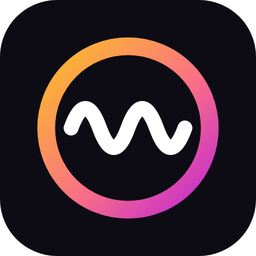
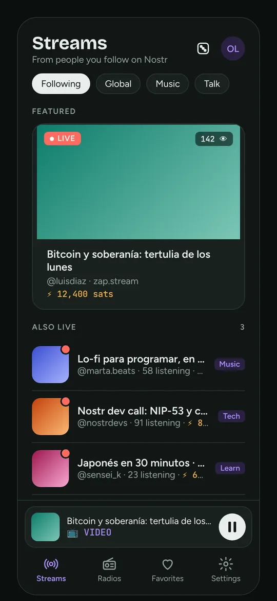
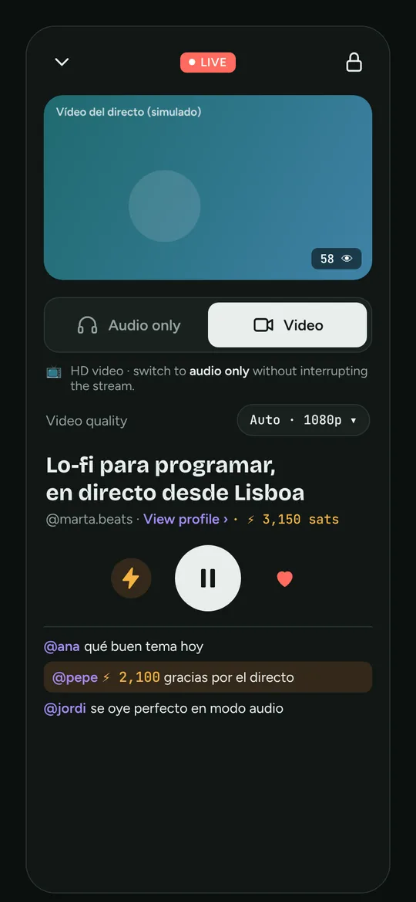
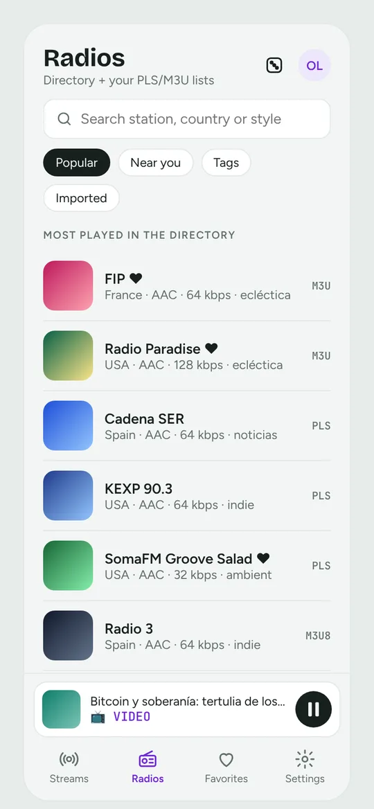
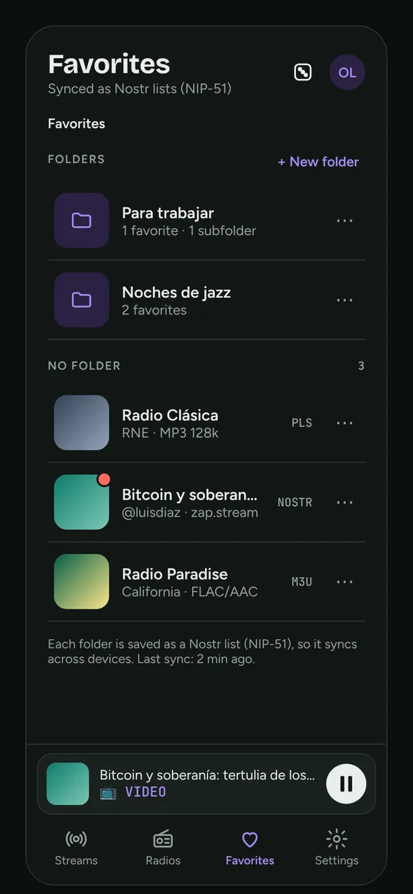

<h1 align="center">Wavestr</h1>

<b>Online radio and Nostr live streams in one app.</b>

<a href="https://oluengo.github.io/wavestr/">Website</a> · <a href="https://oluengo.github.io/wavestr/app/">Open the app</a> · <a href="https://github.com/oluengo/wavestr/releases/latest">Download for Android</a>

<table><tr>
<td width="25%"></td>
<td width="25%"></td>
<td width="25%"></td>
<td width="25%"></td>
</tr></table>

**Wavestr** brings together radio stations from all over the world and live streams from the people you follow on Nostr, with the same favourites and the same player. For Android, in the browser (PWA) and, in beta, on desktop. Free, no ads. In Catalan, Spanish and English.

## What it does

- **Nostr streams (NIP-53)** from people you follow, or from all of Nostr: audio-only or video without cutting the stream, with chat, reactions and zaps.
- **Online radio** with the free Radio Browser directory (popular, by country, by style and search) and PLS/M3U playlist import.
- **Favourites in folders and subfolders**, for stations and streamers. Optional: stored on Nostr, encrypted (NIP-78 + NIP-44).
- **Share** a station, a folder or all favourites, by link, M3U or text.
- **Upcoming and reminders:** scheduled streams (NIP-53) and calendar events (NIP-52), with an alert when they start or before.
- **Zaps with NWC**, with a monthly limit.
- **Android Auto**, widgets, previous/next, sleep timer, buffer against dropouts and per-station volume boost.
- **Surprise button:** radio, stream or both.
- Light, dark or automatic theme, accent colour and side navigation on tablets.

## Install

| | How |
|---|---|
| **Android** | The APK from the [latest release](https://github.com/oluengo/wavestr/releases/latest), or add `https://github.com/oluengo/wavestr` to [Obtainium](https://github.com/ImranR98/Obtainium) to get updates. Also on Zapstore. |
| **Web and PWA** | Open <https://oluengo.github.io/wavestr/app/> and, if you like, install it from the browser. Sign in with a NIP-07 extension, a bunker or your npub; zaps with NWC, WebLN or QR. |
| **Desktop (Linux and Windows)** | In beta: `.deb`, `.tar.gz` and `.msi` in [Wavestr Beta](https://github.com/oluengo/wavestr/releases/tag/wavestr-beta). Needs [VLC](https://www.videolan.org/vlc/). |
| **Beta** | The [Wavestr Beta](https://github.com/oluengo/wavestr/releases/tag/wavestr-beta) pre-release (in Obtainium, “include pre-releases”). Installs separately, as Wavestr Beta, with its own data. |

APK certificate SHA-256 fingerprint (also in Settings → About): `06:23:37:6B:0C:75:09:50:D7:E5:F1:4E:ED:06:C3:B3:C4:86:8B:B2:64:8B:8F:34:34:76:E2:DE:90:70:0F:89`

In the browser, stations that only stream over `http` don't play (they're marked), volume boost depends on the station and reminders alert while the page is open.

## Android Auto

Because Wavestr doesn't come from Google Play, Android Auto hides it until you allow it. You only need to do this once:

1. Install Wavestr (0.10.0 or later) and open it once.
2. Open the Android Auto settings on your phone (search “Android Auto” in Settings).
3. Tap **Version** about 10 times and accept the prompt to enable developer mode.
4. **⋮** menu → **Developer settings** → turn on **Unknown sources**.
5. Disconnect the phone from the car, force stop Android Auto and reconnect.
6. If it doesn't show up: Android Auto settings → **Customise app menu** → tick Wavestr.

If it disappears after an Android Auto update, check that **Unknown sources** is still on.

## Privacy

- **Never sees your private key:** sign with Amber (NIP-55) or a bunker (NIP-46), or sign in read-only with your npub.
- No accounts of its own, no server and no tracking libraries. It connects to Nostr relays, the radio directory and the stations you listen to.
- Favourites are stored on your device; storing them on Nostr is optional and they're encrypted.

## Development

Kotlin + Jetpack Compose (`:core`, `:app` and `:desktop`) and the web app in `web/` (TypeScript + Svelte). [`demo/index.html`](demo/index.html) is an interactive mockup with sample data.

- Build, release and signing (in Spanish): [docs/desarrollo.md](docs/desarrollo.md)
- Technical plan: [docs/plan-tecnico.md](docs/plan-tecnico.md) · Decisions: [docs/decisiones](docs/decisiones/README.md)

## Support the project

If you find Wavestr useful:

- **Lightning / zaps:** `oluengo@rizful.com`
- **Bitcoin:** `bc1pnvdct6hfnh67p7dcg2e5mdveyz8jlxuzv4yflkxqccc72qkuc8ls8raspa`
- **Nostr:** [npub1vuf2g6s0mcjr34lhkg2vvtj4x65w29xn28nznw9fhcqcpyr4zc9q6myguj](https://njump.me/npub1vuf2g6s0mcjr34lhkg2vvtj4x65w29xn28nznw9fhcqcpyr4zc9q6myguj)

---

[Changelog](CHANGELOG.md) · [Report a problem](https://github.com/oluengo/wavestr/issues/new?labels=bug) · [MIT License](LICENSE)

Built with AI · tested by humans. Screenshots from the interactive mockup.
