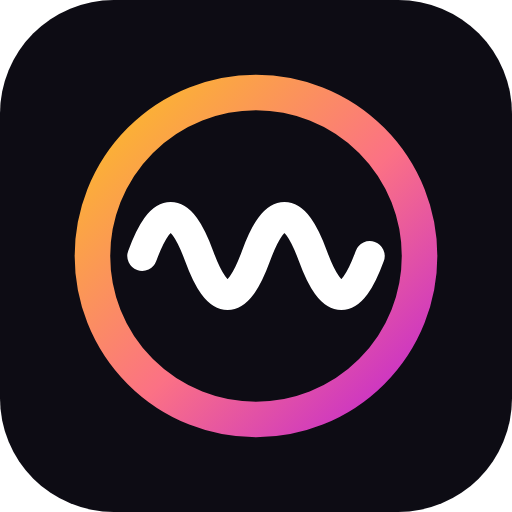

<p align="center"></p>

# Wavestr

Radio online y streams de Nostr en una sola app para Android.
*Online radio and Nostr live streams in one Android app. Català · Español · English.*

> Estado: **beta** ([Wavestr Beta](https://github.com/oluengo/wavestr/releases/tag/wavestr-beta)) con lo último.

## Instalar la beta

La beta se instala como otra app, **Wavestr Beta**, junto a la normal y con sus propios datos. Puede tener fallos.

- **Obtainium:** añade `https://github.com/oluengo/wavestr` y activa «incluir pre-releases». Te avisará de cada nueva beta.
- **Directo:** descarga el APK de la [pre-release Wavestr Beta](https://github.com/oluengo/wavestr/releases/tag/wavestr-beta).

Comprueba que la huella del certificado coincide (también está en Ajustes → Acerca de):
`06:23:37:6B:0C:75:09:50:D7:E5:F1:4E:ED:06:C3:B3:C4:86:8B:B2:64:8B:8F:34:34:76:E2:DE:90:70:0F:89`

## Android Auto

Wavestr aparece en el coche con Favoritos (y sus carpetas), Streams que están emitiendo, Radios (populares y cerca de ti) y Recientes, con búsqueda por voz y anterior/siguiente.

Como no viene de Google Play, Android Auto la oculta hasta que lo permitas. Solo hay que hacerlo una vez:

1. Instala Wavestr (0.10.0 o posterior) y ábrela una vez.
2. Abre los ajustes de Android Auto en el móvil: *Ajustes → Dispositivos conectados → Preferencias de conexión → Android Auto* (o busca «Android Auto» en los ajustes).
3. Baja hasta **Versión** y tócala unas 10 veces seguidas; acepta el aviso para activar el modo desarrollador.
4. Menú **⋮** (arriba a la derecha) → **Ajustes de desarrollador** → activa **Fuentes desconocidas**.
5. Desconecta el móvil del coche, fuerza la detención de Android Auto (*Ajustes → Aplicaciones → Android Auto → Forzar detención*) y vuelve a conectar.
6. Si no sale en el menú del coche: ajustes de Android Auto → **Personalizar menú de aplicaciones** → marca Wavestr.

Si deja de aparecer tras actualizar Android Auto, revisa que **Fuentes desconocidas** siga activado.

¿Algo no va? [Abre un aviso](https://github.com/oluengo/wavestr/issues/new?labels=bug) o usa Ajustes → Acerca de → Informar de un problema.

## Qué hace

- **Streams de Nostr (NIP-53)** de la gente que sigues, o de todo Nostr.
- **Solo audio o vídeo**, sin cortar el stream. Pasa a audio sola al apagar la pantalla y vuelve al vídeo cuando regresas.
- **Solo audio con datos móviles** (opcional) y calidad de vídeo seleccionable.
- **Perfil del streamer** con sus grabaciones.
- **Tres idiomas:** català, castellano e inglés. Usa el del dispositivo; si no es ninguno de ellos, inglés.
- **Tema** claro, oscuro o automático.
- Inicio de sesión con **Amber** (NIP-55) o con tu **npub** en solo lectura. La app nunca ve tu clave privada.

- **Radio online** con el directorio libre Radio Browser: populares, por país, por estilo y búsqueda; calidad seleccionable y canción que suena.
- **Importar listas PLS/M3U** (enlace, contenido o archivo).
- **Favoritos en carpetas y subcarpetas**, para radios y streamers de Nostr.
- **Tu perfil de Nostr** (solo lectura).
- **Zaps con NWC** a los streams, con límite mensual; chat y zaps del stream en el reproductor.
- **Carátulas** de las radios buscadas en su web.
- **Exportar e importar favoritos** (JSON con carpetas o M3U).
- **Color de acento** a elegir.
- **Favoritos en Nostr**, cifrados (NIP-78 + NIP-44, con Amber).
- **Botón sorpresa:** radio, stream o ambos; de tus favoritos o de todo.
- **Relays de Wavestr** editables, además de tu lista NIP-65.
- **Tablets y pantallas anchas:** navegación lateral y reproductor fijo con chat.
- **Widgets** para la pantalla de inicio de Android: barra, reproductor, favoritos y cuadrado.
- **Emisora anterior / siguiente** (favoritos o la lista de origen), también desde la notificación, los auriculares y el coche.
- **Margen contra cortes:** Auto, Directo, 10, 20 o 30 s.
- **Temporizador de apagado:** 15 a 90 minutos con bajada de volumen al final, o al terminar el stream de Nostr.
- **Android Auto:** Favoritos, Streams, Radios y Recientes en el coche, con búsqueda por voz y anterior/siguiente.
- **Chat de los streams:** leer y escribir (con Amber).
- **Escritorio (Linux y Windows):** en desarrollo, todavía sin descargas.

**Próximamente:** radiodespertador y la versión de escritorio. El orden está en el [plan técnico](docs/plan-tecnico.md).

## Demo de la interfaz

[`demo/index.html`](demo/index.html) es una maqueta interactiva de la app completa, con datos de ejemplo. Se abre en cualquier navegador.

## Compilar (desarrollo)

Requisitos: JDK 17, Android SDK 35 (para `:app`) y VLC (para probar `:desktop`).

Módulos: `:core` (Nostr, criptografía, radio, favoritos; Kotlin/JVM sin Android), `:app` (Android) y `:desktop` (Compose Desktop + VLC). El escritorio usa los textos de `app/src/main/res/values*/strings.xml`.

```bash
./gradlew :core:test testDebugUnitTest  # tests
./gradlew assembleDebug                 # APK en app/build/outputs/apk/debug/
./gradlew :desktop:run                  # abre la app de escritorio
./gradlew :desktop:packageDeb           # .deb (en Linux) · :desktop:packageMsi en Windows
python3 scripts/check_strings.py        # comprueba las traducciones
```

GitHub Actions ([`android.yml`](.github/workflows/android.yml)):

- **Push a `main`:** tests, traducciones, APK (y, para pruebas, los instaladores de escritorio) en «Artifacts», una prueba de arranque del APK en un emulador Android y otra del escritorio (xvfb + VLC: radio y vídeo HLS). La beta y las versiones solo se publican si todo eso pasa.
- **Versión normal:** en GitHub, Actions → Build → *Run workflow* (rama `main`) → marcar «Publicar versión». Crea la etiqueta `vX.Y.Z` (la de `wavestrVersion`) y la Release con el APK firmado y las notas de [CHANGELOG.md](CHANGELOG.md). De ahí lo recogen Obtainium y Zapstore. También sirve empujar una etiqueta `v*`.
- **Versión de pruebas (beta):** cada push a la rama `beta` publica la pre-release **Wavestr Beta** (`X.Y.Z-beta.N`). Se instala como otra app (`io.github.oluengo.wavestr.beta`), junto a la normal y con sus propios datos. En Obtainium se añade aparte activando «incluir pre-releases». Cuando la beta está bien, se pasa a `main` y se publica la versión normal.

Firma: secrets `ANDROID_KEYSTORE_BASE64`, `ANDROID_KEYSTORE_PASSWORD`, `ANDROID_KEY_ALIAS` y `ANDROID_KEY_PASSWORD` (mismos nombres que en Usus; la clave es propia del proyecto; su alias es `radiostr`, del nombre anterior, y no hace falta cambiarlo). Sin ellos se genera un APK de depuración y no se publica nada.

## Traducir

Los textos están en `app/src/main/res/values/strings.xml` (inglés), `values-es/` y `values-ca/`. Para añadir un idioma, sigue los pasos del [ADR 0004](docs/decisiones/0004-idiomas.md).

## Documentación

- [Plan técnico](docs/plan-tecnico.md)
- [Decisiones (ADR)](docs/decisiones/README.md)

## Licencia y apoyo

[MIT](LICENSE). Hecha con IA · probada por humanos.

Si te resulta útil, puedes apoyar el proyecto:

- **Bitcoin:** `bc1pnvdct6hfnh67p7dcg2e5mdveyz8jlxuzv4yflkxqccc72qkuc8ls8raspa`
- **Lightning / zaps:** `oluengo@rizful.com`
